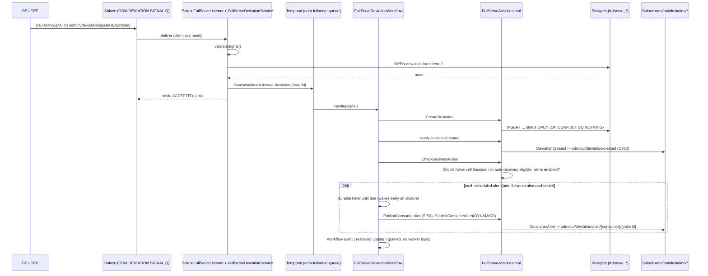
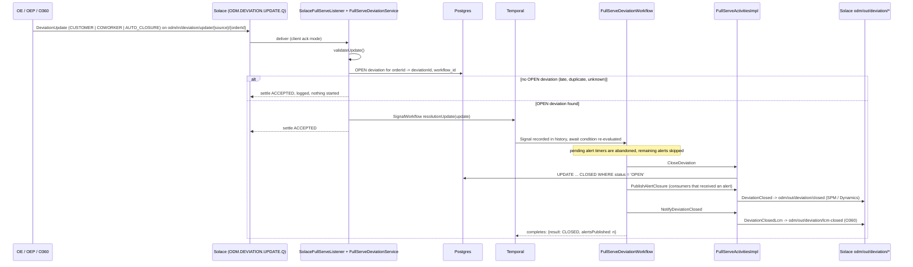

# ODM Full-Serve Deviation Lifecycle - Walkthrough

This document follows a Full-Serve deviation through the code, from the incoming Solace message
to the final closure notifications. It is an ODM-only extension inside `odm-service`. The order
lifecycle (`order-lifecycle-task-queue`) and the autorecovery capability
(`odm-autorecovery-queue`, [autorecovery.md](autorecovery.md)) are unchanged. Full Serve has its
own workflow, task queue, tables, Drools kbase and REST paths.

The POC implements the agreed ODM Full-Serve deviation-handling flow: receive and validate the
signal, ignore it if the order already has an OPEN deviation, create the deviation, evaluate the
business rules, alert consumers, and close the deviation on a resolution update. Payload shapes,
topics and alert configuration are POC assumptions; see
[Assumptions and open questions](#assumptions-and-open-questions) and [Design choices](#design-choices).

Paths below are relative to `odm-service/src/main/kotlin/com/example/odm/`.

## The flow in one picture

```
OE / OEP  --publish-->  odm/in/deviation/signal/{source}/{orderId}  -->  ODM.DEVIATION.SIGNAL.Q
                                                                              | client ack
SolaceFullServeListener --> FullServeDeviationService.receiveSignal: validate, OPEN check, start workflow
                                                                              |
Temporal  FullServeDeviationWorkflow  (fullserve-deviation-<orderId>, odm-fullserve-queue)
   createDeviation (OPEN) -> notifyDeviationCreated (O360) -> checkBusinessRules (Drools)
   -> alert #1..n: durable timer -> publishConsumerAlert (SPM, DYNAMICS)
   -> Workflow.await { resolving update }          <-- Signal resolutionUpdate
   -> closeDeviation (CLOSED) -> publishAlertClosure (SPM/Dynamics) -> notifyDeviationClosed (O360)
                                                                              ^
OE / OEP / O360 --publish--> odm/in/deviation/update/{source}/{orderId} --> ODM.DEVIATION.UPDATE.Q
SolaceFullServeListener --> FullServeDeviationService.receiveUpdate: validate, correlate, Signal
```

## Flow-to-code mapping

| # | Business step | Where | Temporal construct |
|---|---|---|---|
| 1 | Receive deviation signal (OE; OEP for Payment) | `adapters/input/solace/SolaceFullServeListener.kt` `start()` / `consume()` (queue `ODM.DEVIATION.SIGNAL.Q`, client ack). Demo alternative: `adapters/input/web/FullServeDeviationController.kt` `POST /fullserve/deviations/signals` | none (plain adapter) |
| 2 | Validate payload against the contract | `application/service/FullServeDeviationService.kt` `receiveSignal()` -> `validateSignal()` | none: rejected before any workflow exists |
| 3 | Check for an existing OPEN deviation | `FullServeDeviationService.receiveSignal()` (DB check, then `WorkflowExecutionAlreadyStarted`); `FullServeActivitiesImpl.createDeviation()`; partial unique index in `V5__fullserve_deviation.sql` | deterministic Workflow ID `fullserve-deviation-<orderId>` |
| 3a | Start the workflow | `FullServeDeviationService.receiveSignal()` -> `WorkflowClient.start(workflow::handle, signal)` | `StartWorkflowExecution` |
| 4 | Create deviation (OPEN) | `adapters/input/temporal/FullServeDeviationWorkflowImpl.kt` `handle()` -> `adapters/output/temporal/FullServeActivitiesImpl.kt` `createDeviation()` -> `FullServePersistenceAdapter.insertIfAbsent()` | Activity `CreateDeviation` |
| 4b | Send deviation to O360 | `FullServeActivitiesImpl.notifyDeviationCreated()` -> `SolaceFullServePublisher.publish()` on `odm/out/deviation/created` | Activity `NotifyDeviationCreated` |
| 5 | Check business rules | `FullServeActivitiesImpl.checkBusinessRules()` -> `application/service/FullServeRulesEngine.kt` `evaluate()` -> `resources/fullserve/fullserve-rules.drl` | Activity `CheckBusinessRules` |
| 6 | (Auto-recovery) | **Not applicable to Full Serve.** No code path exists. The extension point is a comment in `FullServeDeviationWorkflowImpl.handle()` | none |
| 7a | Schedule consumer alerts | `FullServeDeviationWorkflowImpl.handle()`: `Workflow.await(untilDue) { resolvingUpdate() != null }` | durable Timer |
| 7b | Publish consumer alerts to SPM / Dynamics | `FullServeActivitiesImpl.publishConsumerAlert()` on `odm/out/deviation/alert/{consumer}/{orderId}` | Activity `PublishConsumerAlert` (per consumer, per alert) |
| 7c | Publication exhausted its retries | `FullServeDeviationWorkflowImpl.publish()` catches `ActivityFailure` -> `FullServeActivitiesImpl.recordPublicationFailure()` | Activity `RecordPublicationFailure` |
| - | Wait for a resolving update | `FullServeDeviationWorkflowImpl.handle()`: `Workflow.await { resolvingUpdate() != null }` | durable wait (no worker thread held) |
| 8/9 | Receive deviation update (OE, OEP, O360) | `SolaceFullServeListener` (queue `ODM.DEVIATION.UPDATE.Q`) or `POST /fullserve/deviations/updates` -> `FullServeDeviationService.receiveUpdate()` -> `validateUpdate()`, correlation via the OPEN row's `workflow_id` | Signal `resolutionUpdate` |
| 10 | Close deviation | `FullServeActivitiesImpl.closeDeviation()` -> `FullServePersistenceAdapter.closeIfOpen()` | Activity `CloseDeviation` |
| 11 | Publish alert closure to SPM / Dynamics | `FullServeActivitiesImpl.publishAlertClosure()` on `odm/out/deviation/closed` | Activity `PublishAlertClosure` |
| 11b | Send closure to O360 (LCM) | `FullServeActivitiesImpl.notifyDeviationClosed()` on `odm/out/deviation/lcm-closed` | Activity `NotifyDeviationClosed`; workflow completes with `FullServeOutcome` |

Supporting files:

| File | Purpose |
|---|---|
| `application/ports/input/FullServeDeviationWorkflow.kt` | Workflow interface, Signal method, task queue, Workflow ID rule |
| `application/ports/input/FullServeDeviationUseCase.kt` | Inbound message shapes and intake/update outcomes |
| `application/ports/output/FullServeActivities.kt` | Activity interface and `BusinessRuleDecision` |
| `application/ports/output/FullServeDeviationRepository.kt`, `FullServePublisherPort.kt` | Persistence and publishing ports (in-memory doubles in tests) |
| `domain/model/FullServeDeviation.kt` | Signal, update, deviation, notification, enums |
| `adapters/output/persistence/FullServe*.kt`, `SpringDataFullServeRepositories.kt` | JPA entities and the conditional native inserts/updates |
| `configuration/FullServeConfiguration.kt` | `odm.fullserve.*` properties and the worker on `odm-fullserve-queue` |
| `rules/FullServeFacts.kt` | Drools fact and outcome holder |
| `adapters/input/solace/FullServeDemoConsumer.kt` | **Demo only**: simulated SPM / Dynamics / O360 subscriber |
| `resources/db/migration/V5__fullserve_deviation.sql` | `fullserve_deviations`, `fullserve_notifications` |

## Sequence: signal to consumer alerts (happy path)



## Sequence: resolution and closure



## Runtime sequence in detail

1. **Ingestion.** `SolaceFullServeListener` binds client-acknowledged flows to
   `ODM.DEVIATION.SIGNAL.Q` and `ODM.DEVIATION.UPDATE.Q`. It accepts JSON as a text message or as
   a binary attachment (Solace REST messaging delivers binary). Each message makes exactly one call
   into `FullServeDeviationService`, and the message is settled from that call's outcome:

   | Outcome | Settlement | Why |
   |---|---|---|
   | `ACCEPTED`, `IGNORED_DUPLICATE` (signal); `SIGNALLED`, `NO_OPEN_DEVIATION`, `STALE_DEVIATION_ID`, `WORKFLOW_NOT_RUNNING` (update) | `ACCEPTED` | Reached a defined outcome. Redelivery would change nothing. |
   | `REJECTED_INVALID`, unreadable JSON | `REJECTED` | Redelivery cannot fix the payload. The broker discards it, or moves it to a DMQ if one is configured. |
   | `RETRY_LATER`, any exception (Temporal or Postgres unreachable) | `FAILED` | The broker redelivers the message. |

   A message is never acknowledged before Temporal has accepted the start or the Signal.

2. **Validation** (`validateSignal`). The required fields are `orderId`, `source` (OE or OEP),
   `serviceType` (`FULL_SERVE`), `market`, `deviationType`, `reasonCode` and `occurrence`, where
   the last three must come from the agreed enumerations. `reasonCaused` is optional. The
   enumerations default to the Full Serve values used by this POC and are configurable
   (`odm.fullserve.contract.*`). An invalid signal is answered with every error at once. It never
   creates a row and never starts a workflow.

3. **Duplicates.** Three layers protect against duplicates, each covering a different race:
   - The ingress reads the OPEN row for the order. If one exists, it returns `IGNORED_DUPLICATE`.
   - The Workflow ID is `fullserve-deviation-<orderId>`. Temporal allows one *running* execution
     per ID, so a concurrent second start fails with `WorkflowExecutionAlreadyStarted`. The
     ingress then re-reads the DB. If the OPEN row now exists, the signal is a duplicate.
     Otherwise the running execution is either still creating its deviation or still announcing a
     closure, so the answer is `RETRY_LATER` and the message is redelivered.
   - The partial unique index `uq_fullserve_deviations_open_order` (`order_id WHERE status='OPEN'`)
     means the database itself can never hold two OPEN deviations for an order.

   The reuse policy is `ALLOW_DUPLICATE`, so once a deviation's workflow has completed, a later
   signal for the same order opens a new deviation.

4. **Creation.** The workflow generates `deviationId = "FSD-" + Workflow.randomUUID()`. This is
   replay-safe, so retries reuse the same ID. `createDeviation` inserts the row with `ON CONFLICT
   DO NOTHING`. If the insert conflicts but the row with *this* ID exists, the call was a retry and
   counts as success. If it conflicts because a different OPEN deviation exists, the workflow
   completes with `IGNORED_OPEN_EXISTS`. The row stores `workflow_id` and `run_id`, which link it
   to the Temporal execution.

5. **Business rules.** `fullserve-rules.drl` runs in its own kbase (`fullserveKBase`). One rule
   records that Full Serve is *not eligible for auto-recovery*. One of two rules decides whether
   consumer alerts apply, from the market's alert configuration
   (`odm.fullserve.alerts.enabled-markets`, passed in as `alertConfigEnabled`). The names of the
   rules that fired are stored in `business_rule`. The schedule and consumers come from
   configuration and are returned to the workflow, so they become part of its history.

6. **Alerts.** For each alert in the schedule, `Workflow.await(untilDue) { resolvingUpdate() != null }`
   is a durable timer that also returns early when a resolving update arrives. When the timer
   fires, one `PublishConsumerAlert` Activity runs per consumer. `publishConsumerAlert` also
   refuses to publish if the row is already CLOSED.

7. **Waiting.** `Workflow.await { resolvingUpdate() != null }` parks the execution. No thread,
   connection or poll is held. The deviation stays OPEN for as long as it takes.

8. **Updates.** `receiveUpdate` validates the update, then correlates it through the order's OPEN
   row: deviation, then `workflow_id`, then Signal. An update can never start a workflow. The POC
   policy for each update case:

   | Case | Result |
   |---|---|
   | `resolutionStatus = RESOLVED`, trigger CUSTOMER / COWORKER / AUTO_CLOSURE | Signalled. The deviation closes. |
   | `resolutionStatus = UNRESOLVED` | Signalled and kept in history. The deviation stays OPEN. |
   | No OPEN deviation for the order (unknown, late, or a duplicate after closure) | `NO_OPEN_DEVIATION`: logged, acknowledged, nothing started. |
   | `deviationId` given and not the OPEN one | `STALE_DEVIATION_ID`: ignored. The workflow repeats this check in case of a race. |
   | OPEN row whose workflow is not running (e.g. terminated by an operator) | `WORKFLOW_NOT_RUNNING`: logged as an ERROR for operator attention. |
   | Second resolving update while closing | The first resolving update wins; later ones are ignored. |
   | Invalid (missing field, `AUTO_RECOVERED` trigger, unknown source) | `REJECTED_INVALID`, never signalled. |

9. **Closure.** `closeIfOpen` is `UPDATE ... WHERE status = 'OPEN'`. It is idempotent, and the
   first closure's trigger and timestamp are kept.

10. **Closure notifications.** `DeviationClosed` goes to `odm/out/deviation/closed`, listing the
    consumers that actually received an alert. It is skipped if none did. `DeviationClosedLcm`
    always goes to O360. The workflow completes only after both have reached an outcome, either
    PUBLISHED or FAILED and recorded.

### Retries and failures

| Activity group | Retry policy (in `FullServeDeviationWorkflowImpl`) | After exhaustion |
|---|---|---|
| `lifecycle` stub: CreateDeviation, CheckBusinessRules, CloseDeviation, RecordPublicationFailure | 15 s start-to-close; 1 s initial, x2, max 1 min, **unlimited** attempts | Never exhausts. A Postgres outage delays the lifecycle but cannot abandon an OPEN deviation. A missing Drools verdict is thrown as non-retryable (`FullServeRulesDefect`) and fails the workflow visibly. |
| `publications` stub: NotifyDeviationCreated, PublishConsumerAlert, PublishAlertClosure, NotifyDeviationClosed | 10 s start-to-close; 1 s initial, x2, max 10 s, **5 attempts** | The workflow catches `ActivityFailure`, records a `FAILED` row in `fullserve_notifications` and logs `[ODM operational alert] ...` at ERROR. The lifecycle continues. |

Publication is **publish-once per notification key**
(`<deviationId>:<KIND>:<recipient>[:<alertNumber>]`). A retry finds the PUBLISHED row and skips.
Only a crash between the broker's acknowledgement and the row write can repeat a message, and the
repeat carries the same `eventId`, so consumers can discard it.

`SolaceFullServePublisher` sends **persistent** messages and waits up to 5 s for the broker's
acknowledgement. A NACK or a timeout throws, which triggers the Activity retry. The older
direct-mode publishers in this repository do not wait for the broker in this way.

## Why Temporal here

- **Durable waiting.** A deviation can stay OPEN for days. `Workflow.await` keeps that state in
  Temporal's history, not in memory or a polling job. Restarting `odm-service` loses nothing,
  which was verified live (below).
- **Durable timers.** Alert schedules are server-side timers. If they fall due while no worker is
  running, they fire as soon as one reconnects. They are cancelled simply by the workflow moving
  on when it closes.
- **Signals.** A resolution update is an event *into* an existing lifecycle, recorded in history,
  never a new process.
- **Retries.** Each Activity has its own retry policy. Exhaustion is an explicit, tested branch.
- **History.** Temporal UI (http://localhost:8080) shows each `fullserve-deviation-<orderId>`
  with every Activity, timer and Signal in order, along with the final result.

## Running it locally

Prerequisites, ports and the infrastructure are as described in the [README](../README.md).
Full Serve needs only `odm-service` plus `odm-postgres`, Temporal and Solace:

```bash
cp .env.example .env
docker compose up -d odm-postgres temporal-postgresql temporal-admin-tools temporal \
  temporal-create-namespace temporal-ui solace
# wait until `docker compose ps` shows solace and odm-postgres healthy, then:
cd odm-service
set -a; . ../.env; set +a
ODM_FULLSERVE_ALERT_SCHEDULE=0s,1m,3m ./mvnw spring-boot:run   # short schedule for a demo
```

On startup the log shows `Migrating schema "public" to version "5 - fullserve deviation"` (first
run only), `Provisioned queue ODM.DEVIATION.SIGNAL.Q ...` and
`Consuming ODM.DEVIATION.SIGNAL.Q (client acknowledgement)`.

### Demo through Solace (the real ingestion path)

The local broker's REST messaging port (9000) stands in for OE/OEP publishing:

```bash
# 1. Deviation signal -> 200 from the broker; the listener starts the workflow
curl -s -X POST http://localhost:9000/TOPIC/odm/in/deviation/signal/OE/ORD-7741265 \
  -H 'Content-Type: application/json' \
  -d '{"orderId":"ORD-7741265","source":"OE","serviceType":"FULL_SERVE","market":"US",
       "deviationType":"IKEA_DELAYED_ORDER_STO_ITEM_HANDOUT","reasonCode":"NO_STORE_STOCK",
       "occurrence":"ORDER_PROCESSING","reasonCaused":"FULFILLMENT_UNIT_ALLOCATION_FAILURE"}'

# 2. Deviation, status and publication outcomes
curl -s 'http://localhost:8085/fullserve/deviations?orderId=ORD-7741265'
#   deviation.status = OPEN, businessRule names both rules, notifications:
#   DEVIATION_CREATED/O360, CONSUMER_ALERT/SPM:1, CONSUMER_ALERT/DYNAMICS:1 - all PUBLISHED

# 3. What the simulated consumers received from the broker
curl -s 'http://localhost:8085/fullserve/demo/received?orderId=ORD-7741265'

# 4. Resolution update (after the 1-minute reminder, to see alert #2 too)
curl -s -X POST http://localhost:9000/TOPIC/odm/in/deviation/update/OE/ORD-7741265 \
  -H 'Content-Type: application/json' \
  -d '{"orderId":"ORD-7741265","source":"OE","trigger":"COWORKER","resolutionStatus":"RESOLVED",
       "note":"Co-worker arranged a new hand-out"}'

# 5. CLOSED, plus ALERT_CLOSURE and DEVIATION_CLOSED notifications
curl -s 'http://localhost:8085/fullserve/deviations?orderId=ORD-7741265'
```

Invalid and duplicate signals through Solace: send step 1 again (log: `already has OPEN deviation
... - signal ignored`), or send it without `market` (log: `Deviation signal rejected ...`, message
settled REJECTED). Nothing is left on the queue in either case.

### Demo through REST (same ingress, no broker in front)

| Method and path | Body | Responses |
|---|---|---|
| `POST /fullserve/deviations/signals` | signal JSON as above | `202 ACCEPTED`, `200 IGNORED_DUPLICATE` (with `existingDeviationId`), `400 REJECTED_INVALID` (with `errors`), `409 RETRY_LATER` |
| `POST /fullserve/deviations/updates` | `{"orderId","source","trigger","resolutionStatus","deviationId"?,"note"?}` | `202 SIGNALLED`, `400 REJECTED_INVALID`, `404 NO_OPEN_DEVIATION`, `409 STALE_DEVIATION_ID` or `WORKFLOW_NOT_RUNNING` |
| `GET /fullserve/deviations?orderId=...` | - | every deviation of the order, with its notifications |
| `GET /fullserve/deviations/{deviationId}` | - | one deviation, or `404` |
| `GET /fullserve/demo/received[?orderId=...]` | - | messages the **simulated** consumer received |

Example invalid response:

```json
{"outcome":"REJECTED_INVALID","orderId":"ORD-REST-X","workflowId":null,"existingDeviationId":null,
 "errors":["serviceType is required","market is required","deviationType is required","reasonCode is required","occurrence is required"]}
```

A market not listed in `odm.fullserve.alerts.enabled-markets` (e.g. `SE`) shows the no-alert path.
The deviation opens and closes and O360 is notified, but no consumer alert or alert closure is
sent.

### Configuration

| Property (env var) | Default | Meaning |
|---|---|---|
| `odm.fullserve.alerts.enabled-markets` (`ODM_FULLSERVE_ALERT_MARKETS`) | `US,GB,DE` | markets with an enabled alert configuration (demo values) |
| `odm.fullserve.alerts.consumers` | `SPM,DYNAMICS` | consumers alerted |
| `odm.fullserve.alerts.schedule` (`ODM_FULLSERVE_ALERT_SCHEDULE`) | `0s,2m,10m` | when each alert falls due after creation (demo values) |
| `odm.fullserve.contract.deviation-types` / `reason-codes` / `occurrences` | POC Full Serve values | accepted enumerations |
| `odm.fullserve.destinations.*` | POC queue and topic names | every queue and topic |
| `odm.fullserve.solace.listener-enabled` (`ODM_FULLSERVE_LISTENER_ENABLED`) | `true` | consume the two queues |
| `odm.fullserve.solace.provision-queues` (`ODM_FULLSERVE_PROVISION_QUEUES`) | `true` | **local broker only**: create the queues and topic subscriptions |
| `odm.fullserve.solace.demo-consumer-enabled` (`ODM_FULLSERVE_DEMO_CONSUMER_ENABLED`) | `true` | simulated SPM/Dynamics/O360 subscriber |

For a shared Solace environment: set `SOLACE_HOST`, `SOLACE_VPN`, `SOLACE_CLIENT_USERNAME` and
`SOLACE_CLIENT_PASSWORD` (existing `solace.java.*` settings; no credentials are in the code). Set
`ODM_FULLSERVE_PROVISION_QUEUES=false` and `ODM_FULLSERVE_DEMO_CONSUMER_ENABLED=false`, and have
the queues provisioned with an appropriate max-redelivery count, redelivery delay and DMQ.

## What is real, simulated and unverified

| Area | Status |
|---|---|
| Temporal workflow, timers, Signals, retries | Real. Unit/E2E tests on the time-skipping test server, and live against the docker-compose Temporal server. |
| Postgres persistence, V5 migration, partial unique index | Real. Live against `odm-postgres` (V5 applied on top of an existing V1-V4 schema; index behaviour checked with SQL). Tests use an in-memory double with the same uniqueness rules. |
| Solace ingestion (queues, client ack, settlement) and publishing (persistent, broker ack) | Real against the local docker broker. Not tested against a shared or production broker. |
| OE / OEP publishers | **Simulated** with `curl` to the broker's REST port, or with the REST endpoints. |
| SPM, Dynamics, O360 | **Simulated.** `FullServeDemoConsumer` proves broker delivery to *a* subscriber. No real consumer received or processed anything. |
| Drools rules | Real Drools evaluation. The rule *content* is a POC assumption (see below). |
| Message payload shapes (inbound and outbound) | **POC-defined.** No agreed contract was available. |

Live run results (local docker-compose, alert schedule `0s,1m,3m`):

- A signal published to `odm/in/deviation/signal/OE/ORD-LIVE-1` produced an OPEN row, then
  `DeviationCreated`, then alert #1 to SPM and Dynamics. Every publish was broker-acknowledged and
  received by the simulated consumer.
- A duplicate signal was ignored. A signal without `market` and a malformed JSON message were
  both rejected. The queue showed `msgSpoolUsage 0` afterwards.
- `odm-service` was **stopped before alert #2 fell due and restarted afterwards**. The timer had
  fired on the server, and alert #2 was published within a second of the worker reconnecting.
- The update published to `odm/in/deviation/update/OE/ORD-LIVE-1` was signalled. The deviation
  was CLOSED, `DeviationClosed` and `DeviationClosedLcm` were published, and the workflow
  completed with `{"result":"CLOSED","alertsPublished":4}`. Alert #3 was never published. A late
  update and an update for an unknown order were both acknowledged and ignored.
- 12 concurrent REST signals for one order returned one `202`, five `200` and six `409`, and
  produced exactly 1 row.

Not exercised live: broker outage during publish (covered only by tests with a failing publisher
double), `RETRY_LATER` redelivery through the broker, DMQ behaviour, the Temporal server being
down during ingestion, and multiple ODM instances.

## Assumptions and open questions

POC assumptions. Each is reversible and needs confirmation:

1. **Workflow identity = order.** `fullserve-deviation-<orderId>` follows the agreed rule "at most
   one OPEN deviation per order". Open question: can one order have several deviation types open
   at once? If it can, the ID and the unique index must include the deviation type.
2. **New deviation after closure** is allowed (reuse policy `ALLOW_DUPLICATE`). An old message
   redelivered after its deviation closed would therefore open a new deviation. There is no
   message-ID deduplication.
3. **Field names and values** (`orderId`, `source`, `serviceType = FULL_SERVE`, `market`,
   `deviationType`, `reasonCode`, `occurrence`, `reasonCaused`; update `trigger`,
   `resolutionStatus`, `deviationId`, `note`) are POC-defined, based on the deviation
   classification fields. They are not an agreed schema.
4. **Resolution condition.** `resolutionStatus = RESOLVED` with a CUSTOMER / COWORKER /
   AUTO_CLOSURE trigger closes the deviation. The exact resolution condition is not yet agreed.
5. **OEP Payment deviation type** is not yet defined. OEP is accepted as a
   source, but its Payment type must be added to `odm.fullserve.contract.deviation-types` once it
   is known.
6. **Alert configuration**: the enabled markets, the schedule (`0s,2m,10m`) and "every alert to
   SPM and Dynamics" are demo values. In a real deployment they must come from ODM business
   configuration. Alert user groups (`targetGroup`: RCMP / COM / SFO / CUSTOMER) are not modelled,
   because no mapping is defined yet.
7. **Alert closure** goes only to consumers that received at least one alert. If no alert was
   sent, there is no `DeviationClosed`.
8. **O360** is notified by publishing to `odm/out/deviation/created` and
   `odm/out/deviation/lcm-closed`. Open question: whether O360 should instead be called
   synchronously at ingress (for example for enrichment).
9. **O360 as an update source** is accepted, as the agreed flow lists it. Open question: whether
   customer and co-worker actions reach ODM through OE instead, with O360 publishing nothing.
10. **Publication exhaustion** records `FAILED`, logs an ERROR line that stands in for the
    support team's monitoring alert, and lets the lifecycle continue. The real monitoring channel
    is not integrated.

## Design choices

- **One workflow per deviation.** Intake, the deviation lifecycle and alerting run in a single
  `FullServeDeviationWorkflow` execution. Alerting is a durable-timer loop inside it. Moving
  alerting into a child workflow later would be a contained change.
- **Validation before the workflow.** The ingress validates the payload, so an invalid signal never
  starts a workflow. Validating inside a workflow instead would leave a failed execution behind for
  every invalid message.
- **Workflow ID prefix** `fullserve-deviation-`. This keeps the IDs distinct from other ODM
  workflows in the shared namespace.
- **Topics.** Inbound topics follow `odm/in/deviation/{signal,update}/{source}/{orderId}` and are
  delivered through `ODM.DEVIATION.SIGNAL.Q` and `ODM.DEVIATION.UPDATE.Q`. All destinations are
  configurable. None is confirmed as a production name.

## Known gaps

- No Click & Collect, no auto-recovery branch (by design), and no `targetGroup`.
- Settling `FAILED` redelivers immediately. The locally provisioned queue has unlimited
  redelivery and no delay, so a long Temporal outage causes a tight redelivery loop. Configure a
  redelivery delay and limit on real queues.
- Orphan case: if an operator terminates a workflow while its deviation is OPEN, the row stays
  OPEN. Later signals are ignored as duplicates and updates return `WORKFLOW_NOT_RUNNING`. There
  is no reconciler (the autorecovery capability has one; Full Serve does not yet).
- No Temporal Query and no search attributes. State is read from Postgres and Temporal UI.
- Workflow code changes to long-running executions will need `Workflow.getVersion()`.
